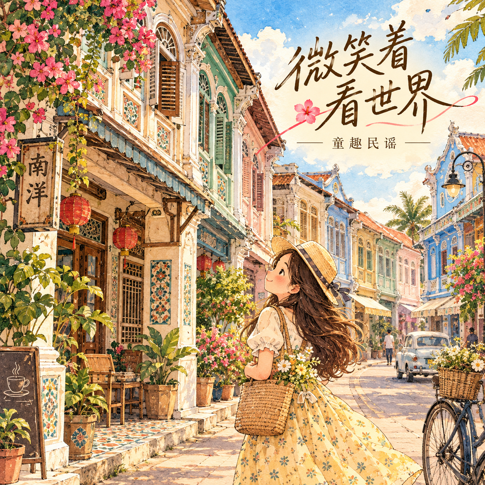

# Project 01 — Smiling at the World

**AI-Assisted Album Cover Design | Creative Direction | Visual Storytelling**

**Chinese Title:** 微笑着看世界  
**Creative Theme:** Nostalgic Nanyang Watercolour  
**Target Audience:** Women aged 25–48  
**Project Status:** Completed — Final Artwork

## 1. Project Overview

*Smiling at the World* (微笑着看世界) is an AI-assisted album cover design exploring childhood wonder, warmth, optimism, and nostalgic Southeast Asian scenery.

The artwork combines watercolour illustration, tropical flowers, heritage architecture, and a sunset coastal landscape to create a gentle, uplifting atmosphere.

The creative brief was developed for women aged 25–48, with the emotionally expressive aesthetic associated with Fish Leong's album artwork serving as an artistic reference.

## 2. Visual Concept

The artwork features a young girl overlooking a colourful coastal town, surrounded by tropical flowers, traditional architecture, and whimsical elements.

Key visual elements include:

- Warm pastel colours and watercolour textures
- Nanyang-inspired heritage architecture
- Tropical hibiscus and bougainvillea
- A youthful character looking towards the horizon
- Whimsical clouds and a decorative kite
- Expressive Chinese calligraphy-style typography

These are observed characteristics of the generated artwork, rather than a claim that every element was individually specified in the original prompt.

## 3. Creative Direction

The original creative brief established three priorities:

- **Audience:** Women aged 25–48
- **Artistic Reference:** An emotionally expressive, approachable album aesthetic inspired by Fish Leong's album artwork
- **Cultural Direction:** A nostalgic Nanyang-inspired visual atmosphere

Existing visual drafts were supplied as references to support the creative direction.

The resulting artwork uses watercolour textures, a warm colour palette, and a coastal landscape composition to communicate a sense of hope, nostalgia, and curiosity.

## 4. AI-Assisted Design Process

**Tool:** ChatGPT / OpenAI Image Generation

The artwork was generated using a concise creative brief and existing Nanyang-inspired visual references.

The creator provided the audience requirements, artistic reference, and cultural direction, then reviewed and selected the resulting artwork.

ChatGPT / AI was also used for Chinese title lettering adjustments, although the exact editing sequence has not been documented.

The original user prompt and further documentation are available here:

- [Prompt Engineering — Original Brief & AI Workflow](prompts.md)
- [Design Decisions — Visual Direction & Evaluation](design-decisions.md)

## 5. Design Evaluation

**Strengths**

- Recognisable nostalgic Southeast Asian visual elements
- Cohesive watercolour illustration style
- Warm and emotionally expressive atmosphere
- Clear visual relationship between the title and illustration
- Alignment with the intended Nanyang-inspired creative direction

**Final Assessment**

The completed design brings together cultural imagery, colour, composition, and illustration to create a warm, nostalgic album cover.

The artwork was selected as the final design for portfolio presentation.

Additional promotional materials or alternative formats may be explored as separate future projects.

## 6. Final Artwork

*Final AI-generated watercolour album cover — Smiling at the World (微笑着看世界).*

### Additional Artwork — Nanyang Flower Lane

## 7. AI Disclosure

The artwork was generated using ChatGPT / OpenAI Image Generation, informed by the creator's original brief and supplied visual references.

The creator provided creative direction, evaluated the output, and selected the final artwork.

The portfolio distinguishes human creative input and design evaluation from AI-generated visual elements.

---
## Artwork Gallery

[View All Album Cover Designs →](GALLERY.md)

**Portfolio Creator:** Joanne Sim  
**Project Type:** Personal Creative Exploration  
**Artwork Status:** Final Artwork
